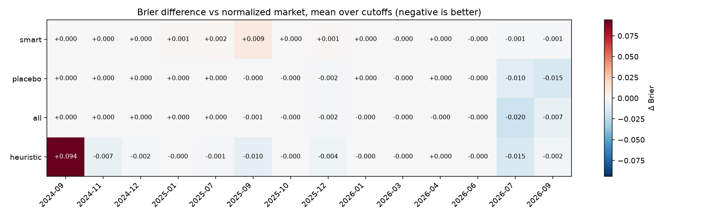
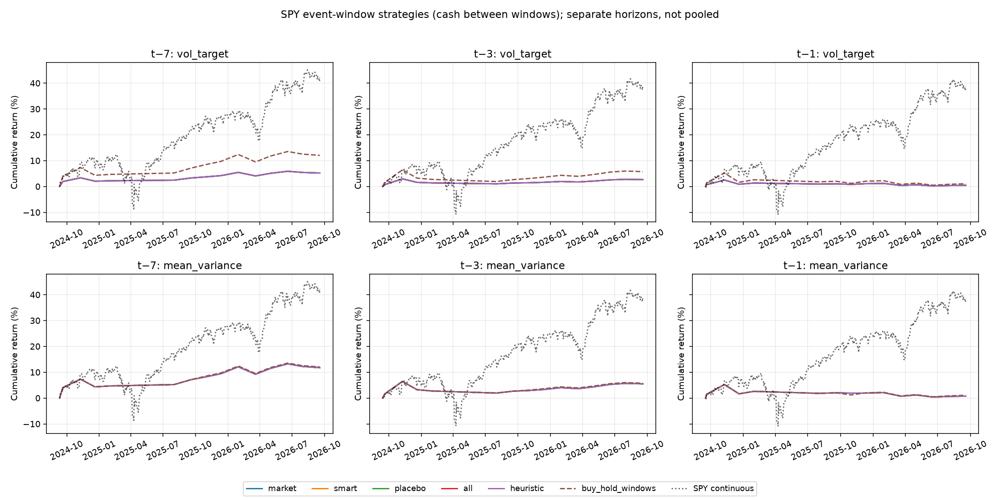

# Wallet probability and SPY portfolio backtest

**Verdict.** The smart-signal calibration does not demonstrate a reliable probability improvement: pooled ΔBrier +0.00082 (95% meeting-bootstrap CI [-0.00015, +0.00232]). Smart log loss is worse by +0.00336; placebo/all-wallet point estimates do better, not evidence of a skill-selection advantage. The largest absolute smart-versus-market mean portfolio return difference is only **0.0305 basis points per window** across the six rule/horizon settings. Only **14 usable meetings** (42 correlated meeting-cutoffs) are available; the first three usable meetings use market-only learned variants. Portfolio results below are exploratory, not evidence of a deployable SPY edge: inspect paired return intervals and placebo/all-wallet controls rather than ranking point estimates. Last-close marking is not a tradable execution assumption. Low power, repeated horizons and multiple comparisons preclude a strong claim.

## Probability accuracy

Multi-outcome Brier is the sum over outcomes (not divided by outcome count). Log loss is −log(probability of the winning outcome). All variants use the identical complete-case smart-available panel: 14 meetings × three cutoffs, September 2024–September 2026. Lower losses and negative differences are better. Pooled CIs resample meetings, retaining all outcomes/cutoffs; signs compare each meeting's mean loss difference.

| Variant | Brier | ΔBrier [95% CI] | Better/worse/tied | Log loss | ΔLog loss [95% CI] | Better/worse/tied |
|---|---:|---|---|---:|---|---|
| market | 0.08011 | +0.00000 [+0.00000, +0.00000] | 0/0/14 | 0.15252 | +0.00000 [+0.00000, +0.00000] | 0/0/14 |
| smart | 0.08093 | +0.00082 [-0.00015, +0.00232] | 4/7/3 | 0.15588 | +0.00336 [+0.00008, +0.00756] | 4/7/3 |
| placebo | 0.07814 | -0.00197 [-0.00469, -0.00001] | 7/4/3 | 0.14932 | -0.00320 [-0.00729, -0.00000] | 8/3/3 |
| all | 0.07802 | -0.00209 [-0.00534, -0.00005] | 9/2/3 | 0.14821 | -0.00431 [-0.00969, -0.00036] | 9/2/3 |
| heuristic | 0.08388 | +0.00377 [-0.00497, +0.01859] | 12/2/0 | 0.14945 | -0.00306 [-0.01483, +0.01483] | 12/2/0 |

### Per-cutoff accuracy

| Cutoff | Variant | Brier | ΔBrier [95% CI] | Log loss | ΔLog loss [95% CI] |
|---|---|---:|---|---:|---|
| t−7 | market | 0.12480 | +0.00000 [+0.00000, +0.00000] | 0.21768 | +0.00000 [+0.00000, +0.00000] |
| t−7 | smart | 0.12674 | +0.00194 [+0.00011, +0.00470] | 0.22232 | +0.00464 [+0.00094, +0.01014] |
| t−7 | placebo | 0.12229 | -0.00251 [-0.00666, -0.00003] | 0.21415 | -0.00353 [-0.00820, -0.00019] |
| t−7 | all | 0.12429 | -0.00051 [-0.00254, +0.00119] | 0.21513 | -0.00256 [-0.00645, +0.00019] |
| t−7 | heuristic | 0.12570 | +0.00090 [-0.00632, +0.01046] | 0.21021 | -0.00747 [-0.01871, +0.00556] |
| t−3 | market | 0.07574 | +0.00000 [+0.00000, +0.00000] | 0.14049 | +0.00000 [+0.00000, +0.00000] |
| t−3 | smart | 0.07592 | +0.00019 [-0.00111, +0.00134] | 0.14301 | +0.00253 [-0.00085, +0.00626] |
| t−3 | placebo | 0.07516 | -0.00058 [-0.00212, +0.00051] | 0.13927 | -0.00121 [-0.00413, +0.00104] |
| t−3 | all | 0.07290 | -0.00283 [-0.00680, -0.00001] | 0.13533 | -0.00515 [-0.01164, -0.00015] |
| t−3 | heuristic | 0.08320 | +0.00746 [-0.00537, +0.03005] | 0.14266 | +0.00217 [-0.01408, +0.02906] |
| t−1 | market | 0.03978 | +0.00000 [+0.00000, +0.00000] | 0.09938 | +0.00000 [+0.00000, +0.00000] |
| t−1 | smart | 0.04012 | +0.00034 [-0.00061, +0.00142] | 0.10230 | +0.00292 [-0.00060, +0.00696] |
| t−1 | placebo | 0.03697 | -0.00281 [-0.00747, -0.00001] | 0.09453 | -0.00485 [-0.01139, -0.00003] |
| t−1 | all | 0.03686 | -0.00292 [-0.00778, -0.00001] | 0.09417 | -0.00521 [-0.01202, -0.00013] |
| t−1 | heuristic | 0.04274 | +0.00296 [-0.00561, +0.01667] | 0.09549 | -0.00389 [-0.01420, +0.01109] |



## SPY event-window portfolios

Each horizon is a separate chronological, non-overlapping 14-window strategy. No horizon pooling into one equity curve. Cash earns zero outside windows and on uninvested capital. Mean, sample volatility and Sharpe are **per event window, not annualized**; Sharpe uses zero risk-free rate. Drawdown includes initial wealth and compounds window returns. Δmean and its paired 95% meeting-bootstrap CI are in **basis points of return** versus the same-rule market (1 bp = 0.01 percentage point). Most adjusted weights nearly coincide with market weights; very small intervals can reflect sparse, tiny nonzero differences rather than persuasive economic value. VaR is a positive loss threshold; breaches count realized loss strictly exceeding predicted portfolio VaR. Kupiec is the asymptotic χ²(1) unconditional-coverage test at 5%, unreliable with just 14 windows. Zero-exposure windows remain in its denominator but cannot breach, so nominal 5% coverage is not exact for those degenerate cash forecasts. `buy_hold_windows` means 100% SPY only during the identical windows, not continuous buy-and-hold; its VaR uses the market scenario mixture at full exposure. Continuous buy-and-hold is reported separately.

| Cutoff | Rule | Variant | Mean | Vol | Sharpe | Max DD | Total | Mean w | VaR breaches | Kupiec p | Δmean bp [95% CI] |
|---|---|---|---:|---:|---:|---:|---:|---:|---|---:|---|
| t−7 | vol_target | market | 0.367% | 0.939% | 0.391 | -1.298% | 5.208% | 0.458 | 2/14 (14.286%) | 0.188 | +0.0000 [+0.0000, +0.0000] |
| t−7 | vol_target | smart | 0.367% | 0.939% | 0.392 | -1.298% | 5.209% | 0.458 | 2/14 (14.286%) | 0.188 | +0.0090 [-0.0024, +0.0235] |
| t−7 | vol_target | placebo | 0.367% | 0.939% | 0.391 | -1.298% | 5.207% | 0.458 | 2/14 (14.286%) | 0.188 | -0.0072 [-0.0162, +0.0003] |
| t−7 | vol_target | all | 0.367% | 0.939% | 0.391 | -1.298% | 5.207% | 0.458 | 2/14 (14.286%) | 0.188 | -0.0089 [-0.0207, +0.0024] |
| t−7 | vol_target | heuristic | 0.367% | 0.939% | 0.391 | -1.299% | 5.206% | 0.458 | 2/14 (14.286%) | 0.188 | -0.0117 [-0.0497, +0.0272] |
| t−7 | vol_target | buy_hold_windows | 0.833% | 1.980% | 0.421 | -2.770% | 12.038% | 1.000 | 2/14 (14.286%) | 0.188 | +46.5971 [-8.3452, +97.3756] |
| t−7 | mean_variance | market | 0.814% | 1.977% | 0.412 | -2.770% | 11.738% | 0.985 | 2/14 (14.286%) | 0.188 | +0.0000 [+0.0000, +0.0000] |
| t−7 | mean_variance | smart | 0.814% | 1.977% | 0.412 | -2.770% | 11.742% | 0.985 | 2/14 (14.286%) | 0.188 | +0.0214 [+0.0000, +0.0641] |
| t−7 | mean_variance | placebo | 0.814% | 1.977% | 0.412 | -2.770% | 11.737% | 0.985 | 2/14 (14.286%) | 0.188 | -0.0091 [-0.0274, +0.0000] |
| t−7 | mean_variance | all | 0.814% | 1.977% | 0.412 | -2.770% | 11.736% | 0.985 | 2/14 (14.286%) | 0.188 | -0.0148 [-0.0444, +0.0000] |
| t−7 | mean_variance | heuristic | 0.813% | 1.977% | 0.412 | -2.770% | 11.730% | 0.984 | 2/14 (14.286%) | 0.188 | -0.0559 [-0.1678, +0.0000] |
| t−7 | mean_variance | buy_hold_windows | 0.833% | 1.980% | 0.421 | -2.770% | 12.038% | 1.000 | 2/14 (14.286%) | 0.188 | +1.9328 [+0.0000, +5.7983] |
| t−3 | vol_target | market | 0.191% | 0.759% | 0.251 | -1.873% | 2.663% | 0.441 | 1/14 (7.143%) | 0.729 | +0.0000 [+0.0000, +0.0000] |
| t−3 | vol_target | smart | 0.191% | 0.759% | 0.251 | -1.872% | 2.664% | 0.441 | 1/14 (7.143%) | 0.729 | +0.0078 [+0.0031, +0.0134] |
| t−3 | vol_target | placebo | 0.191% | 0.759% | 0.251 | -1.873% | 2.662% | 0.441 | 1/14 (7.143%) | 0.729 | -0.0024 [-0.0092, +0.0030] |
| t−3 | vol_target | all | 0.191% | 0.759% | 0.251 | -1.873% | 2.664% | 0.441 | 1/14 (7.143%) | 0.729 | +0.0094 [-0.0032, +0.0262] |
| t−3 | vol_target | heuristic | 0.191% | 0.759% | 0.251 | -1.873% | 2.663% | 0.441 | 1/14 (7.143%) | 0.729 | -0.0009 [-0.0183, +0.0145] |
| t−3 | vol_target | buy_hold_windows | 0.413% | 1.657% | 0.249 | -4.225% | 5.749% | 1.000 | 1/14 (7.143%) | 0.729 | +22.2106 [-21.6437, +69.2462] |
| t−3 | mean_variance | market | 0.395% | 1.656% | 0.239 | -4.225% | 5.493% | 0.936 | 1/14 (7.143%) | 0.729 | +0.0000 [+0.0000, +0.0000] |
| t−3 | mean_variance | smart | 0.396% | 1.656% | 0.239 | -4.225% | 5.498% | 0.936 | 1/14 (7.143%) | 0.729 | +0.0305 [+0.0000, +0.0721] |
| t−3 | mean_variance | placebo | 0.395% | 1.656% | 0.239 | -4.225% | 5.494% | 0.935 | 1/14 (7.143%) | 0.729 | +0.0046 [-0.0552, +0.0722] |
| t−3 | mean_variance | all | 0.396% | 1.656% | 0.239 | -4.225% | 5.498% | 0.934 | 1/14 (7.143%) | 0.729 | +0.0310 [-0.0492, +0.1456] |
| t−3 | mean_variance | heuristic | 0.395% | 1.656% | 0.239 | -4.225% | 5.493% | 0.933 | 1/14 (7.143%) | 0.729 | +0.0012 [-0.1230, +0.1371] |
| t−3 | mean_variance | buy_hold_windows | 0.413% | 1.657% | 0.249 | -4.225% | 5.749% | 1.000 | 1/14 (7.143%) | 0.729 | +1.7353 [-0.6662, +4.9955] |
| t−1 | vol_target | market | 0.035% | 0.774% | 0.045 | -2.260% | 0.447% | 0.478 | 1/14 (7.143%) | 0.729 | +0.0000 [+0.0000, +0.0000] |
| t−1 | vol_target | smart | 0.035% | 0.773% | 0.045 | -2.260% | 0.447% | 0.478 | 1/14 (7.143%) | 0.729 | +0.0016 [-0.0228, +0.0276] |
| t−1 | vol_target | placebo | 0.035% | 0.774% | 0.045 | -2.260% | 0.449% | 0.478 | 1/14 (7.143%) | 0.729 | +0.0144 [-0.0146, +0.0583] |
| t−1 | vol_target | all | 0.035% | 0.774% | 0.045 | -2.261% | 0.448% | 0.478 | 1/14 (7.143%) | 0.729 | +0.0084 [-0.0235, +0.0556] |
| t−1 | vol_target | heuristic | 0.035% | 0.774% | 0.045 | -2.262% | 0.447% | 0.478 | 1/14 (7.143%) | 0.729 | -0.0001 [-0.0388, +0.0408] |
| t−1 | vol_target | buy_hold_windows | 0.088% | 1.601% | 0.055 | -4.504% | 1.068% | 1.000 | 1/14 (7.143%) | 0.729 | +5.3203 [-36.4377, +48.0515] |
| t−1 | mean_variance | market | 0.063% | 1.569% | 0.040 | -4.626% | 0.721% | 0.808 | 1/14 (7.143%) | 0.729 | +0.0000 [+0.0000, +0.0000] |
| t−1 | mean_variance | smart | 0.063% | 1.569% | 0.040 | -4.627% | 0.720% | 0.808 | 1/14 (7.143%) | 0.729 | -0.0059 [-0.0204, +0.0074] |
| t−1 | mean_variance | placebo | 0.063% | 1.569% | 0.040 | -4.626% | 0.730% | 0.809 | 1/14 (7.143%) | 0.729 | +0.0636 [-0.0377, +0.2258] |
| t−1 | mean_variance | all | 0.063% | 1.569% | 0.040 | -4.625% | 0.730% | 0.809 | 1/14 (7.143%) | 0.729 | +0.0681 [-0.0368, +0.2367] |
| t−1 | mean_variance | heuristic | 0.063% | 1.569% | 0.040 | -4.624% | 0.727% | 0.808 | 1/14 (7.143%) | 0.729 | +0.0477 [-0.0281, +0.1597] |
| t−1 | mean_variance | buy_hold_windows | 0.088% | 1.601% | 0.055 | -4.504% | 1.068% | 1.000 | 1/14 (7.143%) | 0.729 | +2.5096 [-12.9438, +18.3521] |



### Continuous SPY buy-and-hold

Held through the gaps, from each horizon's first entry to last exit. Daily-return annualization uses 252 trading days; these are not directly comparable to the event-window Sharpe/volatility above. No out-of-window VaR forecasts are made.

| Cutoff | Start close (UTC) | End close (UTC) | Total | Annualized mean | Annualized vol | Annualized Sharpe | Max DD |
|---|---|---|---:|---:|---:|---:|---:|
| t−7 | 2024-09-10T20:00:00+00:00 | 2026-09-17T20:00:00+00:00 | 42.250% | 18.901% | 16.476% | 1.147 | -18.755% |
| t−3 | 2024-09-13T20:00:00+00:00 | 2026-09-17T20:00:00+00:00 | 38.904% | 17.817% | 16.499% | 1.080 | -18.755% |
| t−1 | 2024-09-16T20:00:00+00:00 | 2026-09-17T20:00:00+00:00 | 38.699% | 17.778% | 16.515% | 1.076 | -18.755% |

## Method and leakage safeguards

- Fit a one-feature, no-intercept binary logistic regression with offset `logit(raw p_market)`, **pooling all three cutoff horizons** from earlier usable meetings. Objective is summed binary negative log likelihood plus `λ β²/2`, fixed **λ=1**; no tuning. Current/future meetings, unresolved prior meetings and rows whose cutoff is not strictly earlier than the target cutoff are excluded. Each outcome/cutoff is one training row; the likelihood is a working binary calibration model, not a multinomial likelihood.
- Fewer than 3 prior usable meetings → β=0, exactly the normalized market vector. Otherwise apply `sigmoid(logit(p_market)+β signal)` then normalize across outcomes. Nonzero tilts clip raw probabilities to [1e-06, 1−1e-06]. Market baseline is raw probabilities normalized. Smart, placebo and all-wallet fits use the same training/evaluation meetings; the fixed smart heuristic uses **k=0.5** without a training minimum. It uses Part A smart flow, not the app's different cluster-pilot data.
- 33 of 42 target cutoffs fit non-fallback coefficients. All coefficient/count records are in `coefficients.csv`; probability vectors in `predictions.csv`; meeting×cutoff losses in `accuracy.csv`.
- The app's `analysis.py::analyze` uses decision-origin fixed-trading-day YES/NO windows and reads its own market probability; it cannot accept this vector or implement the requested cutoff-origin window unchanged. Therefore use the allowed historical per-outcome alternative. Conditional samples are earlier meetings at the **same cutoff horizon**, including pre-wallet meetings. Require both resolution proxy and post-decision exit close strictly before the target cutoff. At least three conditionally matching observations are required; otherwise use all prior meeting-window returns at that horizon. At least two pooled samples are required; there is no future-data fallback. Outcome range containment follows EventLens's convention; ambiguous ranges and `other` use the pooled fallback. Means and sample variances (ddof=1) are never fitted on the target return.
- 84/192 outcome scenario estimates use the pooled fallback. Mixture mean is Σpμ and variance Σp(σ²+μ²)−(Σpμ)². VaR95 is the **moment-matched Gaussian** `max(0, 1.64485 σ−μ)`, not an exact Gaussian-mixture quantile or the app's empirical simulation.
- Daily CSV dates are labels, not close timestamps. Assign each observed SPY close 16:00 America/New_York (DST-aware), then use the latest close ≤ the UTC-midnight cutoff: ordinarily the preceding trading day, **not that cutoff date's future close**. Exit is the close on the first observed trading date strictly after the decision date. Early-close sessions use the same 16:00 proxy; this cannot change midnight inclusion. Returns are close-to-close on the supplied price series; publication/corporate-action revision history is unverified.
- **Execution qualification:** the requested window starts at the last close before the cutoff, but the wallet/market snapshot can contain information arriving between that close and UTC midnight. Returns are hypothetically marked from that observable close, not executable fills after all signals became available. This can bias apparent profitability; a next-open/next-close execution study is required before trading claims.
- Vol targeting: `w=min(1, 0.01/σ_pred)`, a fixed **1% event-window target** for every horizon. Mean-variance: `w=clip(μ/(10 σ²),0,1)`, fixed **γ=10**. No leverage, shorting, costs, slippage, interest or dividends beyond what is embedded in the supplied close series. Zero variance uses w=1 for vol targeting, and w=1 only for positive mean under mean-variance.
- **10,000 paired percentile bootstrap draws**, seed 42, resampling whole meetings. For pooled accuracy, first average differences across a meeting's three cutoffs, then resample meetings; for portfolios resample paired returns within each separate horizon/rule. No multiple-comparison correction. Sign counts treat |difference|≤1e−12 as a tie.

## Limitations

The original wallet universe is retention-limited and retrospectively collected, not a proven contemporaneously available feed. Gamma resolution timestamps are metadata proxies, not verified on-chain finalization times; daily probability publication timestamps are unverified. Deduplication can collapse indistinguishable fills; participant flows are not independent wallet beliefs, holdings or unique economic fills. Few tightening/cutting meetings and sparse per-outcome histories make pooled scenario fallbacks common. A sign reversal or apparently good portfolio result can reflect unstable scenario means, probability normalization and weight clipping, not wallet skill. A meeting bootstrap assumes exchangeability despite regime change and serial dependence. Neither Kupiec non-rejection nor a bootstrap interval establishes calibration or investability at this sample size. Intervals resample the fixed walk-forward predictions, without refitting inside each bootstrap; only one seeded placebo cohort realization is evaluated. No hyperparameter selection was performed, but choosing to investigate this panel remains a research selection effect.

## Reproduce and tests

```sh
python3 -m venv ~/data/polymarket/wallet_backtest_env
~/data/polymarket/wallet_backtest_env/bin/pip install -r models/wallet_backtest/requirements.txt
~/data/polymarket/wallet_backtest_env/bin/python models/wallet_backtest/backtest.py
~/data/polymarket/wallet_backtest_env/bin/python -m unittest discover -s models/wallet_backtest -p 'test_*.py' -v
```

Inputs, implementation SHA-256 hashes, dependency versions and fixed settings are recorded in `backtest_manifest.csv`. Full numeric results (unrounded) are in the companion small derived CSVs. Test output is recorded in the handoff report.
